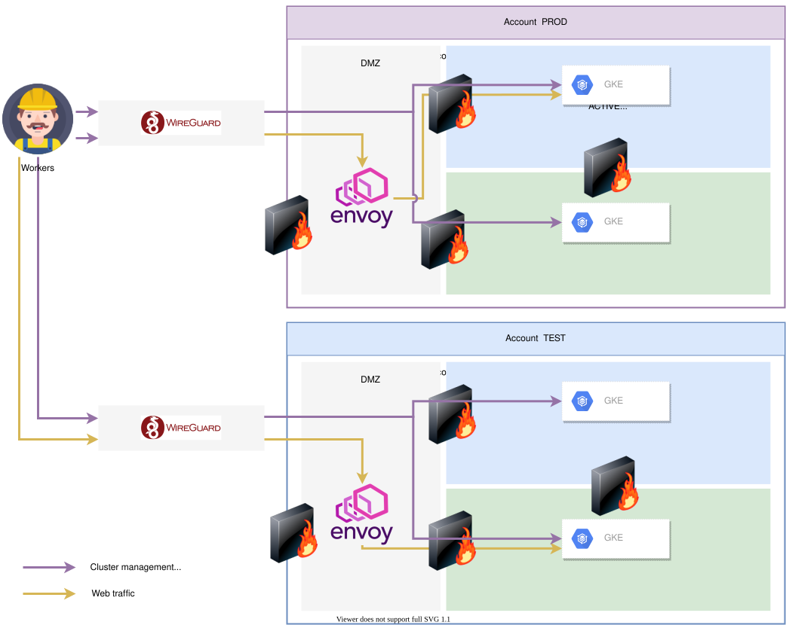

# k8s project

### Architecture





K8S project contain terraform configs, ansible playbooks and other scripts to provision infrastructure.
This GKE setup inspired by best practices according to [Scalable and Manageable: A Deep-Dive Into GKE Networking Best Practices](https://youtu.be/fI-5LkBDap8) and [private cluster example](https://github.com/GoogleCloudPlatform/gke-private-cluster-demo/blob/master/terraform):

1. Regional  cluster
2. VPC-Native
3. Max pods per node
4  use http load balancing
5. private cluster with cloud nat
6. master authorized networks for access


Currently all workloads accessible only over Nginx load balancer on bastion host(which accessible only over wireguard VPN). Nginx doing TCP proxying of TLS traffic based on DNS domain. Traffic is proxied to istio Gateway( which is configured as nodeport). TLS offloading is handled inside cluster by istio gateway. For each cluster we create a separate private DNS zone (with `*` record pointing to nginx). DNS also accessible only through VPN connection. Access to kubernetes APIs are also available through bastion VPN connection.


### Directory structure


Directory tree :
```
.
├── ansible
│   ├── files
│   ├── templates
│   └── vars
├── docs
├── terraform-base
├── clusters
│   └── sandbox
│       ├── blue
│       ├── green
│       └── persistent-resources
└── terraform-modules
    ├── cluster-persistent-resources
    ├── dns
    ├── gke-setup
    ├── k8s-elasticsearch
    ├── k8s-istio
    ├── k8s-misc
    ├── k8s-monitoring-agents
    ├── k8s-post-install-verification
    └── k8s-vault


```

* ansible - contains ansible playbooks and all needed for it's execution. playbooks executed from terraform configs and modules.
* docs - contain howtos and other documentation that cover this projects
* terraform-base - base terraform configs for provisioning VPC, Bastion host, storage , service account, etc...
* clusters - directory contain configs for all k8s clusters
  * sandbox - sandbox clusters related terraform configs
  * blue - terraform configs to spinup GKE blue environment
  * green - terraform configs to spinup GKE green environment
  * persistent-resources - terraform configs for shared resources (buckets,keys,etc.)
* terraform-modules - umbrella directory for all modules
  * cluster-persistent-resources - provision buckets for vault and elasticsearch
  * dns - module to configure internal dns zone
  * gke-setup - terraform module to create GKE cluster  in secure way(at least from network perspective).
  * k8s-elasticsearch - terraform module for elasticsearch provisioning within k8s cluster
  * k8s-istio - module for istio provisioning within k8s
  * k8s-misc - miscelenious k8s operators
  * k8s-monitoring-agents - module to spin up and configure monitoring agents within k8s cluster
  * k8s-vault - module to spin up and configure Vault
  * k8s-post-install-verification - module to run post install verification playbook


### Authorization reference

Currently to run terraform successfully you have to define 3 environment variables:

```
export GOOGLE_CREDENTIALS=~/terraform_key.json
export GOOGLE_REGION=us-east4
export GOOGLE_PROJECT=silent-eye-276318

```
GOOGLE_CREDENTIALS - path to service account key, which will be used to provision all resources. Terraform service account managed within terraform-base configs
GOOGLE_REGION - region where you want to spin up resources.
GOOGLE_PROJECT - GCP project name

[More info on terraform GCP provider configuration reference](https://www.terraform.io/docs/providers/google/guides/provider_reference.html)

variables must be defined in `.env` file and alias `tf` should be used to run deployment


### Ansible SSH authorization
Currently terraform creates one-time ssh-key and put it into `ssh-agent`. `ssh-agent` should be running and session environment variables should be set to terraform process.

Terraform will wipe out all keys stored in `ssh-agent` and create only one to use. Then this key will be authorized to perform logins on behalf of terraform's service account( which key specified in GOOGLE_CREDENTIALS) to login to instances for 30 minutes. after terraform execution completion key still be accessible in running `ssh-agent` instance.

### K8S authorization
All post-deployment activities currently done with same service account which run terraform so it also should be capable to manage gke clusters. Terraform requests bearer token and pass it to ansible to perform istio setup and to helm provider to setup cert-manager. Test workloads created after cluster provisioning also with same credentials. This scheme allows to not store credentials on disk.

### Bucket to store terraform state
Terraform may store it's state locally or in remote object storage(S3,GCP Storage, etc ). [More info](https://www.terraform.io/docs/backends/types/gcs.html).

Currently it is require to provision sample bucket and create access to Service Account who will be run terraform. Exact `gcloud` commands mentioned in terraform-base README file.


## Install packages requirements
All tools required for deployment served as docker image. Alias works only in `zsh`. To build Dockerfile and define alias `tf` next command should be executed:

```
source .env
```


## Network requirements
To successfully reach k8s cluster API server you will have to connect to bastion with wireguard. Linux `wg` worked well for this. Configuration for VPN connection may be achieved from Bastion Subspace. Currently subspace automatically provisioned with bastion host in  `terraform-base`
